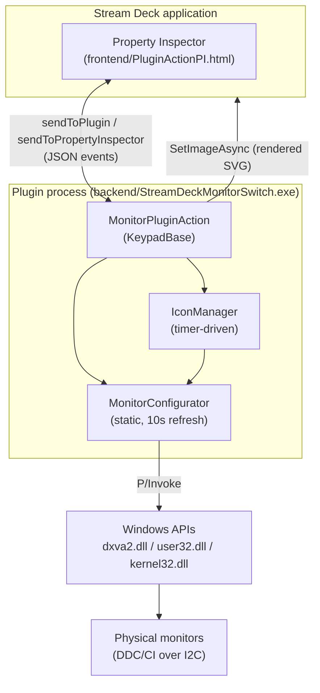

# Architecture

## Overview

StreamDeckMonSwitchMKI is a standard Stream Deck plugin composed of three parts:

1. **Backend** — a C# WinExe launched by the Stream Deck application as a subprocess. It owns all monitor access and key rendering.
2. **Frontend** — an HTML Property Inspector (PI) shown in the Stream Deck configuration panel. It only collects settings; all data comes from the backend.
3. **CI/CD** — an Ansible/Docker pipeline that builds both parts and composes the final `.sdPlugin` directory.

## Component diagram



## Backend modules

| Module | File(s) | Responsibility |
|---|---|---|
| Entry point | `Program.cs` | Calls `SDWrapper.Run(args)` (StreamDeck-Tools) |
| Action | `src/Actions/MonitorPluginAction.cs` | Key lifecycle, settings, applying VCP values, PI communication |
| Monitor access | `src/MonitorConfigurator/MonitorConfigurator.cs` | Enumerates monitors, parses capabilities, reads/writes VCP |
| VCP definitions | `src/MonitorConfigurator/VCP.cs` | Known VCP codes, names, permissions |
| Icon rendering | `src/IconsManager/IconManager.cs` | Builds SVG icons, polls monitor status, pushes images |
| DTOs | `src/DTOs/*` | JSON payloads sent to the Property Inspector |

See [Backend](./backend.md) for details.

## Data flow

### Configuration (Property Inspector → backend)

1. PI loads; its `sdpi-checkbox-list-custom` elements request data by sending `sendToPlugin` events: `getMonitors`, `getProperties`, `getValues`.
2. Backend responds with `sendToPropertyInspector` payloads built from the DTOs (`InspectorDataSourceDTO` with nested items/groups).
3. User selections are written into the action's settings object (see [Settings schema](./settings-schema.md)) and persisted by the Stream Deck SDK (`SetSettingsAsync`).

### Execution (key press)

1. `KeyPressed` iterates `Settings.VCPActionsSettings` (monitor model → VCP codeName → value).
2. For each entry it finds the matching `PhysicalMonitor` and calls `MonitorConfigurator.SetVCPFeature(handle, code, value)`.
3. The icon outline is tinted per result: orange while working, yellow on success, red on failure.

### Live status (background)

- `MonitorConfigurator` re-enumerates monitors every **10 s** (`UPDATE_PERIOD_MS`) and fires `OnUpdateMonitors`.
- `IconManager` runs a timer (due 5 s, period 2 s). Each tick it reads `INPUT_SELECT (0x60)` and `POWER_MODE (0xD6)` per monitor and re-tints registered icons:
  - **Outline** — lime green when all configured input selects already match, white otherwise.
  - **Power button** — green/red/yellow/gray for ON/OFF/SLEEP/UNKNOWN.

## Threading notes

- `MonitorConfigurator.Monitors` is replaced wholesale on each refresh; consumers read the current list reference. Monitor handles (`hPhysicalMonitor`) are re-acquired each refresh.
- `IconManager` guards its timer callback with a `TimerState` (`IDLE`/`WORKING`) to avoid overlapping updates.
- `IsChangingVCP` on the action prevents re-entrant VCP writes while a key press is being processed.

## Plugin directory structure (release)

The composed `.sdPlugin` folder mirrors `manifest.json` paths:

```
StreamDeckMonSwitchMKI.sdPlugin/
├── manifest.json            # CodePath: backend/StreamDeckMonitorSwitch.exe
├── backend/                 # compiled exe + dependencies
├── frontend/                # PluginActionPI.html + sdpi-components.js + jquery
└── img/                     # icons (pluginIcon, categoryIcon, pluginAction, SVGs)
```
