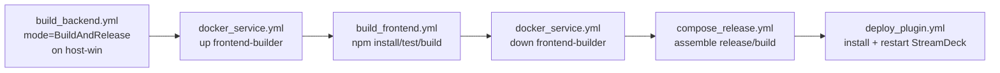

# CI/CD

Build and deploy automation for the plugin. Because the application has two differently-built halves (C# backend on Windows, npm frontend in Linux containers), the pipeline uses **Ansible playbooks** orchestrated across a Docker controller container, a frontend-builder container, and the Windows host over SSH.

## Layout

```
ci_cd/
├── ansible.ps1                  # entry point: runs a playbook via docker compose
├── compose.yaml                 # ansible-ctl + frontend-builder services
├── post_build.sh                # helper to run the post-backend-build playbook
├── containers/
│   ├── ansible_controller.dockerfile   # alpine + ansible + ssh tooling
│   └── worker_frontend.dockerfile      # python alpine + npm + sshd (ansible node)
├── data/                        # container entrypoints
├── inventory/inventory.yml      # hosts: frontend-builder, host-win
├── inventory/secrets.yml        # (vaulted/secret vars)
└── playbooks/
    ├── build_backend.yml        # devenv build on host-win
    ├── build_frontend.yml       # npm install/test/build in frontend-builder
    ├── docker_service.yml       # compose up/down/build a service on host-win
    ├── compose_release.yml      # assemble release/build (.sdPlugin contents)
    ├── deploy_plugin.yml        # copy to Stream Deck plugins dir, restart StreamDeck
    └── full_build_and_deploy.yml# runs all of the above in order
```

## Running a playbook

From `ci_cd/` (PowerShell):

```powershell
.\ansible.ps1 -playbook full_build_and_deploy
# optional extra vars:
.\ansible.ps1 -playbook build_backend -extravars '{ "mode": "ReleaseAndRun" }'
```

`ansible.ps1` ensures Docker Desktop is running, then runs `docker compose --profile ansible up` with `command: "${PLAYBOOK}"`, so the `ansible-ctl` container executes the chosen playbook.

## Inventory

| Host | Connection | Role |
|---|---|---|
| `ansible-ctl` | localhost | controller; also runs `compose_release.yml` locally |
| `frontend-builder` | ssh (`ansible/ansible`) | npm build worker (container) |
| `host-win` | ssh → `host.docker.internal` (user `JJ`, cmd shell) | Windows build host + deploy target |

Shared vars: `plugin_home=/opt/plugin_home` (repo mounted into containers), `release_dir=/opt/release`.

## Full pipeline (`full_build_and_deploy.yml`)



1. **Backend** — `devenv StreamDeckMonSwitchMKI.sln /Build '<mode>'` on the Windows host (requires `devenv_path` host var).
2. **Frontend worker** — compose starts `frontend-builder`; the playbook copies the fork into `/opt/workplace`, runs `npm install --force`, `npm audit fix`, tests, and `npm run build_only`, then copies `sdpi-components.js` back.
3. **Compose release** — on the controller, wipes and rebuilds `release/build/`:
   - `manifest.json` from `backend/`
   - `backend/` ← `backend/bin/ReleaseAndRun/`
   - `img/` ← `backend/img/` + `frontend/img/`
   - `frontend/` ← `frontend/property_inspector/` + built `sdpi-components.js(.map)`
4. **Deploy** — on `host-win`: stop Stream Deck, replace the plugin directory under the Stream Deck plugins folder (`release_plugins_dir\release_plugin_dir_name`), copy `release/build/` in, then relaunch Stream Deck via a scheduled task (interactive processes can't be started over remote SSH directly).

## Known issues

- **`[Gathering Facts]` fails on Windows with "Access denied for Get-CimInstance"** — see [PowerShell/Win32-OpenSSH#2077](https://github.com/PowerShell/Win32-OpenSSH/issues/2077); workaround in [vscode-remote-release#2648 comment](https://github.com/microsoft/vscode-remote-release/issues/2648#issuecomment-1293832539).
- Deploy requires WMI permissions for remote method execution (used to stop/start Stream Deck).
- `deploy_plugin.yml` restarts Stream Deck through a registered scheduled task (`RunStreamDeck`) because `Start-Process` cannot launch interactive GUI apps over a remote session.
